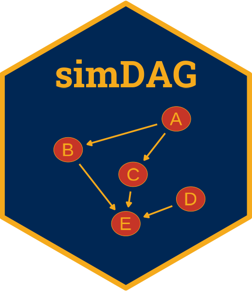

<!-- README.md is generated from README.Rmd. Please edit that file -->

```{r, include = FALSE}
knitr::opts_chunk$set(
  collapse = TRUE,
  comment = "#>",
  fig.path = "man/figures/README-",
  out.width = "100%"
)
```

<!-- badges: start -->
[](https://www.repostatus.org/#active)
[](https://cran.r-project.org/package=simDAG)
[](https://cran.r-project.org/package=simDAG)
[](https://github.com/RobinDenz1/simDAG/actions/workflows/R-CMD-check.yaml)
[](https://app.codecov.io/gh/RobinDenz1/simDAG)
[](https://doi.org/10.18637/jss.v116.i02)
<!-- badges: end -->

# simDAG 

**Simulate complex data from explicit data-generating processes in R**

`simDAG` is an R package for generating synthetic data from directed acyclic graphs (DAGs). Users specify how variables are generated and how they depend on one another, and may then simulate datasets from the resulting data-generating process (DGP).

Beyond ordinary cross-sectional data, `simDAG` supports complex longitudinal processes, time-to-event outcomes, censoring, recurrent and competing events, and dependencies between individuals through networks. It additionally implements an enhanced `formula` interface, allowing specifications of arbitrary interactions, non-linear effects, dependencies on categorical variables and random effects. The development version also supports calibrating conditional model parameters to achieve user-defined target characteristics, including marginal effects.

## Installation

Install the current CRAN release:

```{r, eval=FALSE}
install.packages("simDAG")
```

To install the development version from GitHub, including the new `calibrate_dag()` functionality:

```{r, eval=FALSE}
install.packages("remotes")
remotes::install_github("RobinDenz1/simDAG")
```

## Quick start

Suppose we want to generate data with a continuous covariate $X$, a binary treatment $A$, and a binary outcome $Y$. Both treatment and outcome depend on $X$, and the outcome also depends on treatment.

```{r, warning=FALSE, message=FALSE}
library(simDAG)

dag <- empty_dag() +
  node("X", type="rnorm", mean=0, sd=1) +
  node("A", type="binomial",
       formula= ~ -0.5 + X * 0.6) +
  node("Y", type= "binomial",
       formula= ~ -1 + A * 0.7 + X * 0.4)

set.seed(43)
data <- sim_from_dag(dag, n_sim=10000)
head(data)
```

The DAG below represents the data-generating process: $X$ influences both treatment ($A$) and outcome ($Y$), while $A$ also influences $Y$.

```{r, dag-plot, fig.width=7, fig.height=5, out.height="45%", out.width="45%", fig.align="center"}
plot(
  dag,
  layout = "in_circle",
  node_size = 0.3,
  node_fill = "grey85",
  node_text_fontface = "bold"
)
```

Each node is generated according to its specified distribution or conditional model. The order of the nodes and their dependencies define the data-generating process. The same approach extends to much more complex DGPs, including custom generation functions and longitudinal processes.

## What can you simulate?

| Use case | Main functionality |
|---|---|
| Cross-sectional data from a DAG | `sim_from_dag()` |
| Longitudinal data with time-varying variables | `sim_discrete_time()` |
| Continuous-time event-driven data | `sim_discrete_event()` |
| Data with dependencies between individuals | `network()` functionality |
| Data with custom conditional models | Custom `node()` types and generation functions |
| Data with prespecified marginal characteristics | `calibrate_dag()` (development version) |

The package implements many node types for user convenience, including linear-, logistic-, Poisson- and Cox-,   regression models, among many others. See `node()` for an overview. 

### Cross-sectional data

Generate data from static DAGs containing continuous, binary, categorical, count, and time-to-event variables. Nodes can be specified using conditional distributions, regression models or custom functions.

**Learn more:** [Simulating Data from a Known DAG](https://robindenz1.github.io/simDAG/articles/v_sim_from_dag.html)

### Longitudinal data and survival processes

Use `sim_discrete_time()` to generate complex longitudinal data with time-varying covariates, time-dependent effects, censoring, recurrent events, and competing events.

For suitable models, `sim_discrete_event()` offers an alternative based on event-driven simulation in continuous time. It can be considerably faster than discrete-time simulation, although it supports a narrower range of time-dependent processes.

**Learn more:** [Discrete-time simulation](https://robindenz1.github.io/simDAG/articles/v_sim_discrete_time.html) · [Discrete-event simulation](https://robindenz1.github.io/simDAG/articles/v_sim_discrete_event.html)

### Network-dependent data

`simDAG` also supports dependencies between individuals through static and dynamic network structures, allowing the generated data to incorporate network-based relationships.

**Learn more:** [Simulating Data from a DAG with Network Dependencies](https://robindenz1.github.io/simDAG/articles/v_sim_networks.html)

## Specify marginal targets instead of manually tuning coefficients

When defining a DGP through conditional models, the resulting marginal characteristics are not always obvious. For example, specifying the coefficients of a logistic regression model does not directly specify the marginal prevalence of its outcome or the marginal causal effect of treatment.

The `calibrate_dag()` function addresses this problem by allowing users to leave selected parameters unspecified and determine them numerically so that user-defined targets are achieved as closely as possible.

For example, suppose we want an outcome prevalence of 30%, while retaining the specified relationships between treatment, a confounder, and the outcome.

```{r}
ldag <- lazy_dag(
  empty_dag() +
    node("X", type="rnorm", mean=0, sd=1) +
    node("A", type="binomial",
         formula= ~ -0.5 + X * 0.8) +
    node("Y", type= "binomial",
         formula= ~ param(intercept_Y) +
           A * 0.7 + X * 0.4)
)

targets <- list(
  prevalence_Y = list(
    target = 0.30,
    eval_fun = function(data) mean(data$Y)
  )
)

params <- list(
  intercept_Y = list(
    start = 0,
    range = c(-5, 5)
  )
)

fit <- calibrate_dag(
  lazy_dag = ldag,
  targets = targets,
  params = params,
  n_sim_run = 5000,
  n_sim_eval = 20000,
  seed = 42
)

summary(fit)
```

The result includes the calibrated parameters, the achieved target values, and optimization diagnostics. The resulting fully specified DAG is available as `fit$dag` and can be used with the usual simulation functions.

Calibration is numerical and approximate. Inspect the achieved target values rather than relying solely on optimizer convergence.

**Learn more:** [Calibrating a DAG to Match Target Characteristics](https://robindenz1.github.io/simDAG/articles/v_calibrate_dag.html)

## Documentation and examples

- [Package introduction and JSS paper](https://robindenz1.github.io/simDAG/articles/simDAG.html)
- [Cookbook: examples of different DGPs](https://robindenz1.github.io/simDAG/articles/v_cookbook.html)
- [Specifying formulas in a DAG](https://robindenz1.github.io/simDAG/articles/v_using_formulas.html)
- [Defining custom node types](https://robindenz1.github.io/simDAG/articles/v_custom_nodes.html)
- [Function reference](https://robindenz1.github.io/simDAG/reference/index.html)

If you are unsure which simulation approach fits your problem, the introductory vignette and cookbook are good places to start.

## Citation

If you use `simDAG` in your research, please cite:

Denz, R. and Timmesfeld, N. (2026). Simulating Complex Cross-Sectional and Longitudinal Data using the simDAG R Package. *Journal of Statistical Software*, 116(2). https://doi.org/10.18637/jss.v116.i02

## Contributing

Bug reports, questions about unexpected behavior, and feature requests are highly welcome. Please open an [issue on GitHub](https://github.com/RobinDenz1/simDAG/issues).

## License

`simDAG` is released under the GNU General Public License, version 3 or later (GPL-3).
